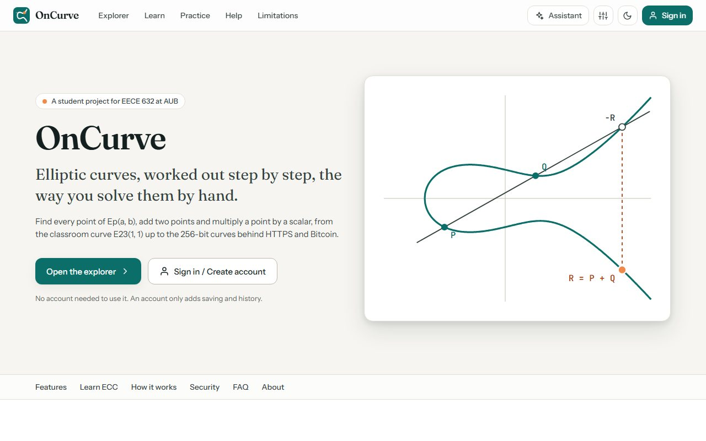
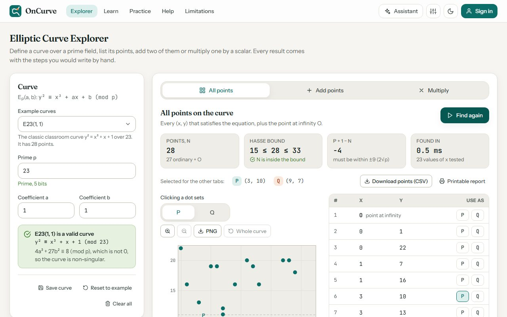
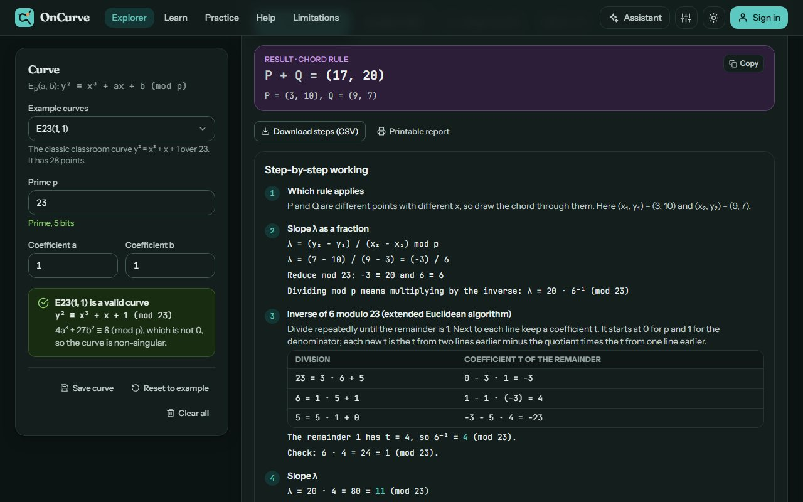
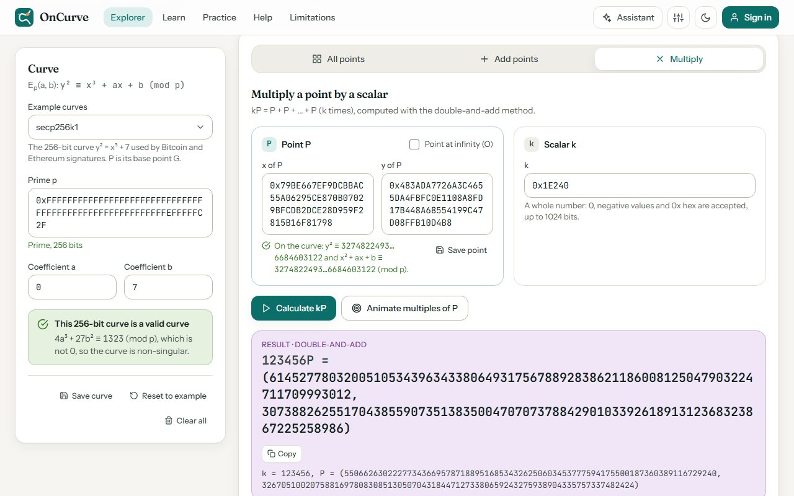
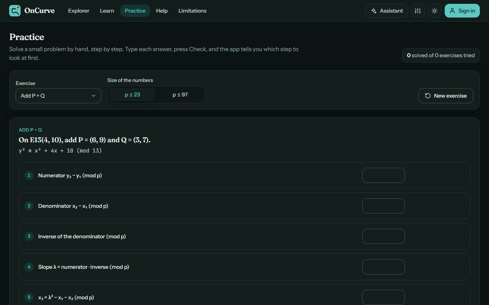

# OnCurve: Elliptic Curve Explorer

OnCurve is a learning app for elliptic curves over a prime field, written Ep(a, b):

    y² ≡ x³ + ax + b (mod p)

Given p, a and b it finds every point on the curve, adds two points and multiplies a
point by a scalar. Every result shows the same steps you would write when solving it by
hand: the slope, the modular inverse by the extended Euclidean algorithm, x₃ and y₃, and
the double-and-add table. It works on classroom curves such as E23(1, 1) and on the real
256-bit curves secp256k1 and NIST P-256.

**Live version:** coming with the hosted deployment (the app runs fully on your own
computer in the meantime, see below).

The app opens on a short landing page. **Open the explorer** goes straight to the
calculator, with no account; **Sign in / Create account** is only needed to save work.

## Quick start

You need [Node.js](https://nodejs.org) LTS (version 22 or newer). Nothing else.

1. Download or clone this folder.
2. Run the one-time setup (installs, creates the local database and the demo account,
   builds the website):

       npm run setup

3. Start the app; it opens in your browser:

       npm start

On Windows you can instead double-click **`start-windows.bat`**; on macOS,
**`start-mac.command`**. Both check that Node.js is installed and run the setup the first
time. Everything except the assistant's optional AI mode works without internet.

### Demo account

| Email                | Password             |
| -------------------- | -------------------- |
| `demo@oncurve.local` | `Elliptic-Demo-2026` |

It comes with saved curves, a saved point and a short history. Its recovery codes (for
trying "Forgot your password?") are written to `data/demo-recovery-codes.txt` by the
setup. An account is optional: every calculation works as a guest.

## Features

**The three tasks**

- **Curve setup** with live checks: p must be a prime greater than 3, a and b are reduced
  mod p, singular curves (4a³ + 27b² ≡ 0) are refused with the reason. Seven example
  curves, from E23(1, 1) and E17(2, 2) to secp256k1 and NIST P-256.
- **Find all points** for p up to 200,000: runs in the background with a progress bar,
  then shows the count with Hasse's bound, a paged table, and an interactive plot (hover
  for coordinates, click to choose P or Q, zoom and drag; a density view for large p).
- **Add two points** (and doubling) with every step written out.
- **Multiply a point** by any scalar up to 1024 bits with the double-and-add table; any
  row opens to show its own working. An animation walks P, 2P, 3P, … back to O.

**Learning**

- **Learn ECC** topics: four short reads (what an elliptic curve is, point addition,
  scalar multiplication, ECC in real life with P-256 and secp256k1), each with a worked
  example computed by the engine and a button that opens it in the Explorer.
- **Learn** page: the curve over the real numbers with the chord-and-reflect picture, next
  to the same addition mod p; double-and-add; why ECC is secure, with a key exchange worked
  out by the engine.
- **Practice** mode: solve an addition, a doubling, an inverse, an on-curve check or a
  multiplication by hand; the app checks each step and points to the first mistake.
- **Assistant**: answers questions and explains your last result from the engine's own
  step data. It works offline; with a server key and a signed-in user it can use AI mode
  (OpenAI by default, or Anthropic, chosen in `.env`), whose tools are backed by the same
  engine.
- Guided **tour** on the first visit (replayable), **Help** page, keyboard shortcuts.

**Comfort and export**

- Light and dark themes, four text sizes, Reset and Clear all, copy buttons.
- CSV downloads of the points, the steps of an addition and the double-and-add table; the
  plot as a PNG picture; a printable report (or PDF) of everything calculated.

**Accounts (optional)**

- Guests see a small banner (closable for the session) and can press Save too: it explains
  that saving needs an account, and after signing in or signing up the app returns to the
  same screen and finishes the save.
- Save curves and points, a history of every calculation with one-click reload, and
  preferences and practice progress kept with the account.
- Security center: change password, two-factor authentication with an authenticator app,
  recovery codes, signed-in sessions (end any or all), recent activity, delete the account.
  How each protection works is in [SECURITY.md](SECURITY.md).

|                                                                                   |                                                                       |
| --------------------------------------------------------------------------------- | --------------------------------------------------------------------- |
|  |  |
|              |              |

The pictures are taken from the running app by `npx tsx scripts/capture-screens.ts`.

## Limitations

Stated openly, and also on the app's Limitations page:

- Listing every point works up to p = 200,000; adding and multiplying work for any prime
  up to 1024 bits, including the 256-bit curves.
- The plot draws single dots up to 400 values across and a density view beyond.
- Only curves y² = x³ + ax + b over a prime field with p > 3.
- Educational use only: the calculations are not hardened against timing attacks.
- Primality is proven below about 3.3 × 10²⁴ and probabilistic (24 Miller-Rabin bases)
  above.
- The assistant's AI mode needs an internet connection and allows 50 questions a day for
  all users together (20 an hour per user); after that the offline helper answers.

## Turning on the assistant's AI mode (optional)

The assistant works without any key, using its offline helper. To turn on AI mode, edit
the file **`.env`** in the project folder and restart the app. Keys stay on the server;
never paste one anywhere else.

| Line in `.env`                | What it does                                                                                                              |
| ----------------------------- | ------------------------------------------------------------------------------------------------------------------------- |
| `AI_PROVIDER=openai`          | Who receives the questions: `openai` (the default) or `anthropic`.                                                        |
| `OPENAI_API_KEY=`             | Put your OpenAI key after the `=` when the provider is `openai`.                                                          |
| `OPENAI_MODEL=gpt-6-luna`     | The OpenAI model; the default is `gpt-6-luna`.                                                                            |
| `OPENAI_REASONING_EFFORT=low` | How hard the model thinks (`none`, `low`, `medium`, …, or `default`). A value the model refuses is dropped automatically. |
| `ANTHROPIC_API_KEY=`          | Put your Anthropic key after the `=` when the provider is `anthropic`.                                                    |
| `AI_DAILY_LIMIT=50`           | AI questions per UTC day across all users; `0` turns AI mode off.                                                         |

**Which provider receives the questions.** Only the one named by `AI_PROVIDER`, even when
both keys are set. It receives the question, the last few messages of the chat, a short
description of the current curve and points, and the results of the engine's tools; never
an email address or a password. With OpenAI, requests ask it not to store the response
(`store: false`). The assistant panel and the Security page show the provider in use.

**Restricting an OpenAI key.** The app calls one endpoint only, the Responses API:
`POST https://api.openai.com/v1/responses`, with function calling. It does not use Chat
Completions. A restricted key needs access to Responses and nothing else.

When the daily cap is reached, or OpenAI reports a rate limit, an exhausted budget or a
model the key may not use, the offline helper takes over.

**Every number is checked.** Before an AI answer is shown, the server checks that every
point (x, y) and every number right after "=" or "≡" appears in a tool result, the
question, the current work or an earlier message. If one does not, the model is asked once
to fix it; if it fails again, the offline helper answers instead. Numbers elsewhere in the
prose, such as "a 256-bit curve", are not checked.

## Troubleshooting

| Problem                                | What to do                                                                               |
| -------------------------------------- | ---------------------------------------------------------------------------------------- |
| `node` is not recognized               | Install Node.js LTS from nodejs.org, then open a new terminal window.                    |
| `npm start` says the app is not set up | Run `npm run setup` once first.                                                          |
| The browser does not open              | Open the address printed in the window (normally http://localhost:3000).                 |
| Port 3000 is busy                      | The app moves to the next free port and prints it. To choose one: `PORT=4000 npm start`. |
| The page is blank                      | Use a current Chrome or Edge, and keep the window that runs the app open.                |
| Starting from scratch                  | Stop the app, delete the `data` folder, run `npm run setup` again.                       |

## Development

    npm run dev        # website with live reload on http://localhost:5173 (run `npm run serve` too for the API)
    npm run check      # lint, type check, unit, property and server tests
    npm run test:e2e   # browser tests (first time: npx playwright install chromium)

| Folder        | What lives there                                                    |
| ------------- | ------------------------------------------------------------------- |
| `shared/ecc/` | The elliptic curve engine (BigInt, no dependencies).                |
| `client/`     | The website (React, Vite, Tailwind CSS).                            |
| `server/`     | The Node.js server (Fastify), accounts and the assistant's AI mode. |
| `tests/`      | Unit, property and server tests, and browser tests in `tests/e2e`.  |
| `docs/`       | Design notes and screenshots.                                       |

The engine is checked against an exhaustive search for every curve over the primes 5, 7,
11, 13, 17, 23 and 97, against the group laws, and against an independent library for
secp256k1 and P-256. See [CONTRIBUTING.md](CONTRIBUTING.md) for the team rules and
[docs/design-notes.md](docs/design-notes.md) for the decisions made along the way.
